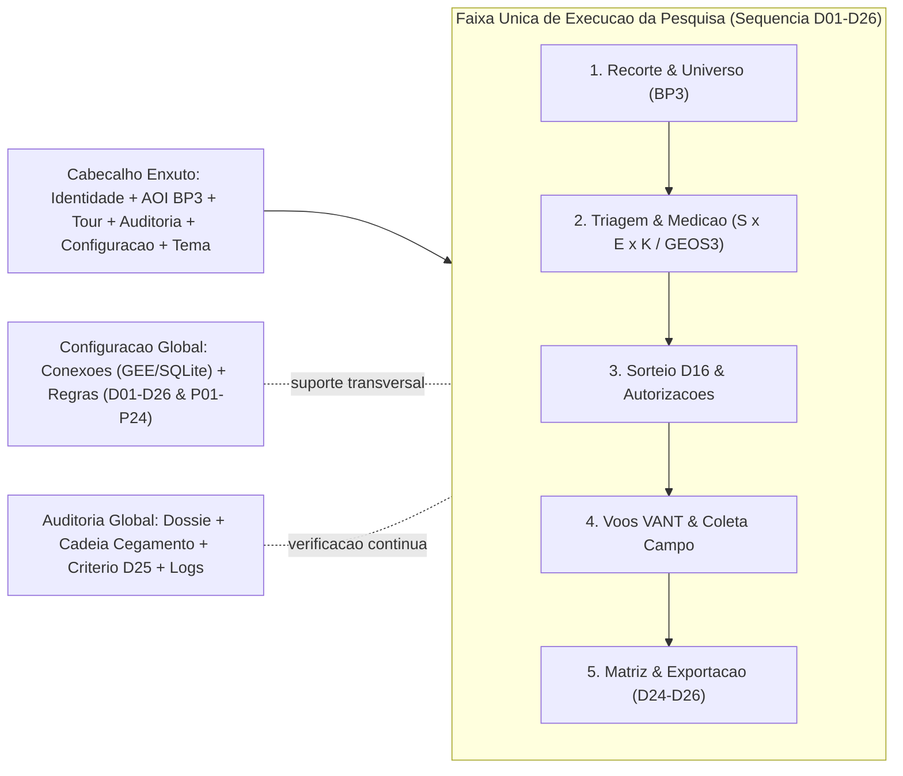
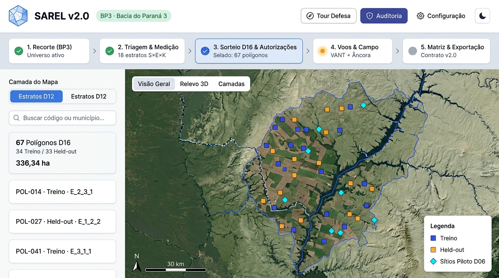
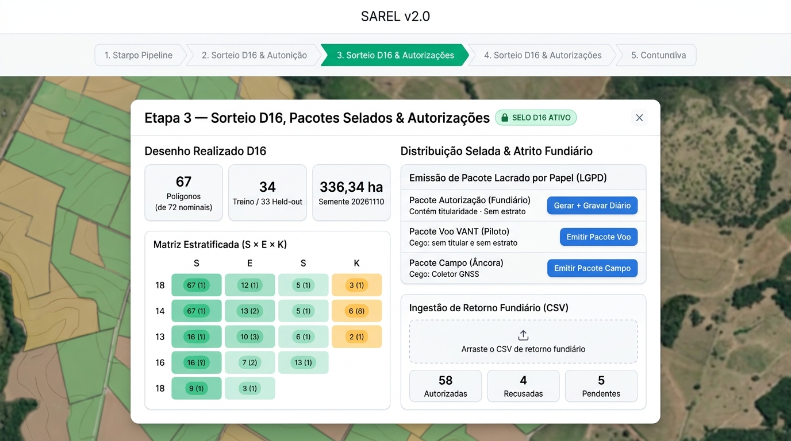
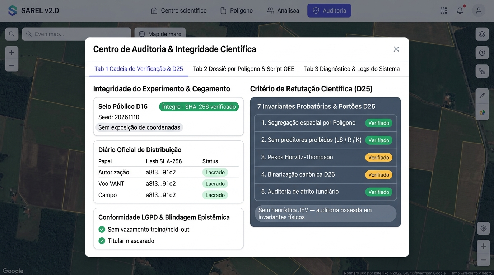
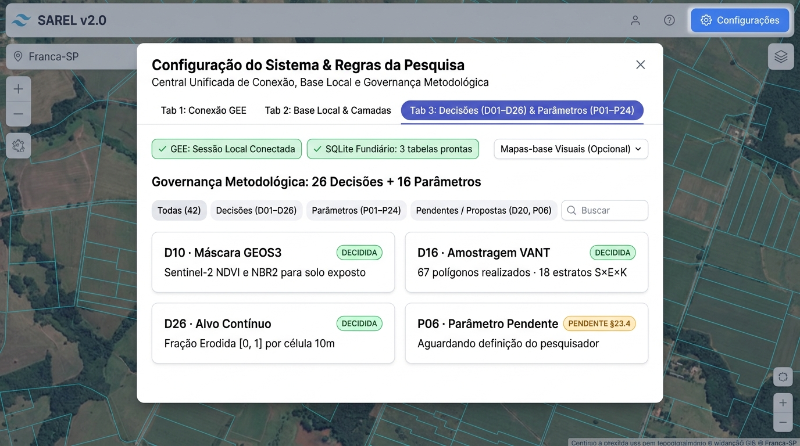
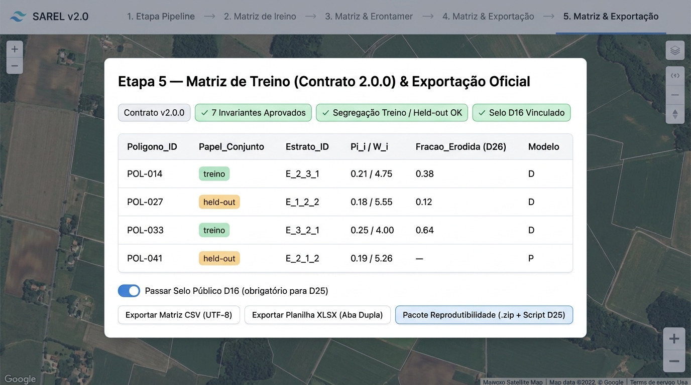

# Análise Profunda de Interface, Aderência Metodológica e Plano de Ação — SAREL v2.0

> [!IMPORTANT]
> **Escopo deste documento:** Análise exclusivamente diagnóstica e propositiva gerada sem alteração no código-fonte da aplicação ou em scripts (`npm run estado:verificar` validado em `OK`). Nenhuma refatoração no código foi executada.

---

## 1. Resumo Executivo e Resposta à Sua Proposta

**Sua leitura está correta em dois eixos:**
1. **A interface atual sofre de redundância estrutural, sobreposição visual e fragmentação modal.** O usuário enxerga simultaneamente **9 controles no cabeçalho** ([`Header.tsx`](../../src/components/layout/Header.tsx)), **8 cartões na barra de fluxo** ([`BarraFluxoOperacional.tsx`](../../src/components/fluxo/BarraFluxoOperacional.tsx)), **controles flutuantes no mapa que colidem entre si**, uma **barra lateral com seletores que duplicam botões do topo** e **11 modais operacionais** (+ 3 componentes do Tour de Defesa) em [`page.tsx`](../../src/app/page.tsx).
2. **Manter `Configuração` e `Auditoria` como botões/centros persistentes e resumir o restante na sequência de execução da pesquisa é a arquitetura ideal.** Hoje acontece o inverso: o cabeçalho repete etapas operacionais que já existem na barra logo abaixo (`Área`, `Triagem/GEE`, `Campanha`, `Matriz`), a `Auditoria` foi colocada como um "passo 8" do pipeline (que inclusive falha em silêncio se não houver ponto selecionado), e a `Exportação` ficou espalhada em **4 lugares diferentes**.

Além da poluição visual, a verificação profunda revelou um problema metodológico mais sério: **vários botões, parâmetros e textos da interface pertencem a versões anteriores ao desenho `D16`/`D25`/`D26`**, enquanto **módulos reais já prontos e testados** (como emissão de pacotes selados com SHA-256 em [`pacoteDistribuicao.ts`](../../src/lib/export/pacoteDistribuicao.ts) e ingestão de autorizações/recusas em [`csvAutorizacoes.ts`](../../src/lib/autorizacao/csvAutorizacoes.ts)) continuam sem ligação com a interface.

---

## 2. Diagnóstico das Capturas de Tela (`Tela01` a `Tela18`) e do Layout Atual

A inspeção das 18 imagens em [`docs/auditorias/Telas App 11_26/`](../auditorias/Telas%20App%2011_26/) confrontada com o código de apresentação ([`tourMetodologico.ts`](../../src/config/tourMetodologico.ts) e [`ApresentacaoSpotlight.tsx`](../../src/components/presentation/ApresentacaoSpotlight.tsx)) mostra exatamente onde a interface quebra ou confunde:

### 2.1 Achados Visuais Diretos nos Prints

| Print | Passo / Contexto | O que foi observado na tela | Causa no código |
| :--- | :--- | :--- | :--- |
| `Tela01 11_11.png` | Workspace padrão (0 pontos) | Botão `"Visão Geral"` corta `"Delimitar Talhão / Polígono"` (fica `"elimitar Talhão / Polígono"`). Legenda `"CLASSES DA PESQUISA"` invade a barra de escala `30 km`. `8 Auditoria` aparece `"Disponível"`, mas não abre nada ao clicar. | [`MapControls.tsx`](../../src/components/map/MapControls.tsx) (`top-4 left-4`) colide com [`DrawingToolbar.tsx`](../../src/components/polygon/DrawingToolbar.tsx) (`top-4 left-1/2`). Legenda em [`MapViewer.tsx`](../../src/components/map/MapViewer.tsx#L839) (`bottom-6 left-6`) sobrepõe `ScaleControl`. [`AuditDossierModal.tsx`](../../src/components/audit/AuditDossierModal.tsx#L37) retorna `null` se `pontoAuditoria === null`. |
| `Tela03 11_11.png` | Tour 2/17 (`Relevo 3D`) | Spotlight do elemento fica fora de área útil / escondido sob o modal explicativo. | Alvo `terreno-3d` no canto esquerdo do mapa compete com o posicionamento do modal do tour. |
| `Tela07 11_11.png` | Tour 6/17 (`Spatial Thinning`) | Destaca a pílula informativa `0 Amostras` no `Header`, que nem sequer é clicável/configurável para explicar thinning. | Âncora de `thinning-espacial` foi apontada para o contador estático de amostras. |
| `Tela08`, `Tela14`, `Tela15` | Tour 7/17 (`Fator C`), 13/17 (`Cadeia Verificação`), 14/17 (`Dossiê`) | **Três passos metodológicos completamente distintos apontam para o mesmo botão `8 Auditoria`** na `BarraFluxoOperacional`. | Ausência de ancoragem específica e sobrecarga semântica no passo 8. |
| `Tela09 11_11.png` | Tour 8/17 (`Fator K Pedologia`) | Modal ainda exibe textos antigos de revisão anterior: *"Mannigel et al. (2002) e Coelho et al. (2024)"* e *"Latossolo Vermelho Eutroférrico (K=0.015)..."*. | [`tourMetodologico.ts`](../../src/config/tourMetodologico.ts#L466-L494) não foi totalmente alinhado à D14 (Embrapa Doc. 246 / `k_solos`). |
| `Tela11 11_11.png` | Tour 10/17 (`Campanha & Rótulos`) | Texto apresenta *"KoboToolbox, Drones e Índice Kappa"* e concordância entre *"Fotointerpretação e Visita de Campo"*. | [`tourMetodologico.ts`](../../src/config/tourMetodologico.ts#L565-L590) permanece pré-D16 (Kobo e Fase A foram aposentados por D16). |
| `Tela12 11_11.png` | Tour 11/17 (`Matriz de Treino`) | Promete *"eliminação recursiva de covariáveis com VIF > 5.0"* e *"Spatial Block CV"* na Central da Matriz. | O módulo da matriz ([`montagem.ts`](../../src/lib/matriz/montagem.ts)) monta tabelas; não há cálculo de VIF implementado em `src/lib/matriz/` nem na tela. |
| `Tela13`, `Tela16`, `Tela17` | Tour 12/17, 15/17, 16/17 (`Decisões`, `Conexões`, `Diagnóstico`) | O menu dropdown da engrenagem abre automaticamente e **cobre os cartões `7 Matriz` e `8 Auditoria`** da barra logo abaixo. | Dropdown `w-64` de [`Header.tsx`](../../src/components/layout/Header.tsx#L101-L111) sobrepõe exatamente a segunda linha de fluxo. |

### 2.2 Redundâncias Estruturais entre `Header`, `BarraFluxoOperacional` e `Sidebar`

Hoje o usuário enfrenta **quatro pontos de entrada competindo pelo mesmo fluxo**:

- **Área de Estudo (3 entradas + 1 toggle interno):** botão no `Header` (`Nenhuma área ativa 0`), cartão `1 Área` na barra de fluxo, seletor na `Sidebar` ([`RegionAndTopNSelector.tsx`](../../src/components/sidebar/RegionAndTopNSelector.tsx)) e caixa de alteração dentro do [`CandidateSelectionModal.tsx`](../../src/components/region/CandidateSelectionModal.tsx).
- **Triagem GEE (2 entradas):** `Amostragem GEE` no `Header` e `2 Triagem` na barra de fluxo.
- **Campanha (2 entradas):** `Campanha & Rótulos` no `Header` e `6 Campo` na barra de fluxo (apesar de `PainelCampanhaModal` conter a aba de VANT D16 que seria do passo `5 Voos`, cujo próprio cartão na barra nem abre modal — `modalDestino: null`).
- **Matriz (2 entradas):** `Matriz de Treino` no `Header` e `7 Matriz` na barra de fluxo.
- **Exportação (4 entradas distintas):** botão `Exportar` no `Header` ([`ExportModal.tsx`](../../src/components/export/ExportModal.tsx)), Aba 3 de [`PainelCampanha.tsx`](../../src/components/campanha/PainelCampanha.tsx#L295-L301), botão `Imprimir em Planilha XLSX` no [`CandidateSelectionModal.tsx`](../../src/components/region/CandidateSelectionModal.tsx#L410-L446) e `Exportar Relatório (.md)` em [`CalculadoraDesenhoAmostral.tsx`](../../src/components/decisoes/CalculadoraDesenhoAmostral.tsx).
- **Contagem de Amostras (4 locais):** pílula `0 Amostras` no `Header`, aba da `Sidebar`, dropdown `RegionAndTopNSelector` e título em [`PointCardList.tsx`](../../src/components/sidebar/PointCardList.tsx).

---

## 3. Verificação Profunda: O Que Não Pertence Mais à Pesquisa, Código Morto e Desalinhamentos

### 3.1 Botões, Parâmetros e Telas Que Não Pertencem à Pesquisa Atual (`D01`–`D26`)

| Item / Botão | Onde está | Por que não pertence à pesquisa atual | Risco se removido sem cuidado (Travas de Teste) |
| :--- | :--- | :--- | :--- |
| **1. Jev (TypeSafe AI) — Motor System One** | [`ApiTokensManager.tsx`](../../src/components/config/ApiTokensManager.tsx#L420-L495), `/api/jev/test`, `/api/jev/auditar`, [`jevClient.ts`](../../src/lib/jev/jevClient.ts), [`fallbackLocal.ts`](../../src/lib/jev/fallbackLocal.ts) | Nunca integrou nenhuma decisão `D01`–`D26`; usa heurística local arbitrária (escala 0–4) ou API externa proprietária; seu único consumidor na UI ([`InspetorPonto.tsx`](../../src/components/inspetor/InspetorPonto.tsx)) nem sequer está montado. | [`ApiTokensManagerN15.test.ts`](../../src/components/config/ApiTokensManagerN15.test.ts), [`sessaoEfemera.test.ts`](../../src/lib/seguranca/sessaoEfemera.test.ts), [`InspetorPonto.test.ts`](../../src/components/inspetor/InspetorPonto.test.ts). |
| **2. Desenho Manual de Talhão para Amostragem GEE** | [`DrawingToolbar.tsx`](../../src/components/polygon/DrawingToolbar.tsx) montada em `MapViewer.tsx:823` | Promete que polígono desenhado à mão *"servirá de máscara delimitadora na próxima Amostragem GEE"*. Contradiz o desenho probabilístico na BP3 (`D12`/`D16`) e causa o corte visual da `Tela01`. | [`useModalA11y.test.ts`](../../src/hooks/useModalA11y.test.ts#L61-L73) exige que `DrawingToolbar.tsx` exista na lista fechada dos 11 diálogos. |
| **3. Subamostra Corredor Foz–Céu Azul (20%) e Partição 40/10/4** | [`CandidateSelectionModal.tsx`](../../src/components/region/CandidateSelectionModal.tsx) (`proporcaoInLocoCorredorPct=20`, `tamanhoAmostra=50`, `raioThinningKm=5.0`, `frequenciaSoloNuMin=0.15`) e `"Combo Híbrido BP3"` em [`RegionRequestModal.tsx`](../../src/components/region/RegionRequestModal.tsx) | A **Decisão `D16`** superou integralmente a partição em corredor e os 50 pontos: a pesquisa adotou **72 polígonos nominais / 67 realizados de 5,02 ha (`Ŝ × Ê × K̂`) + 60–80 pontos de campo em âncora de prevalência**. Além disso, `D12` usa tercis empíricos (`t1=0,0116`, `t2=0,0490`) sem pré-corte em `0,15`, e `P02` define thinning por distância real em metros. | [`acessibilidadeAlvosERotulos.test.ts`](../../src/components/layout/acessibilidadeAlvosERotulos.test.ts) testa `htmlFor="subamostra-in-loco"` em `CandidateSelectionModal.tsx`; [`padroesProibidos.ts`](../../src/lib/seguranca/padroesProibidos.ts) tem isenções por linha. |
| **4. Seletor Estado Todo / Municípios fora da BP3 no fluxo primário** | [`RegionRequestModal.tsx`](../../src/components/region/RegionRequestModal.tsx) (`Selecionar o Estado Todo como Área`) | O universo amostral oficial da dissertação é exclusivamente a **Bacia do Paraná 3 (BP3)**. Permitir selecionar "o Estado do Paraná inteiro" na tela principal de execução induz erro de escopo. | Verificar [`paridadeArtefatos.test.ts`](../../src/config/paridadeArtefatos.test.ts) caso texto citado em exceções seja movido. |
| **5. Aba 4 "Legado Superado (D16)" + Perfil `"interpretacao-cega"`** | [`PainelCampanha.tsx`](../../src/components/campanha/PainelCampanha.tsx#L295-L301) e `#L891-L966` | Expõe upload legado do **KoboToolbox** e card da **Fotointerpretação Visual (Fase A)** dentro da central operacional de Campanha, e ainda lista `"interpretacao-cega"` nos botões de exportação enquanto **omite `"autorizacao"`** (que existe em [`perfis.ts`](../../src/lib/matriz/perfis.ts#L251-L263)). | `padroesProibidos.ts` referencia linhas de `PainelCampanha.tsx`; `perfisIntegridade.test.ts` / `travaCegamentoPerfis.test.ts` testam os 5 perfis em `lib/matriz` (manter na biblioteca histórica se necessário, remover só da UI operacional). |
| **6. Bloco de "Demonstração com Pixels Fictícios" na Campanha** | [`PainelCampanha.tsx`](../../src/components/campanha/PainelCampanha.tsx#L616-L701) | Botão `"Executar demonstração com pixels fictícios (GSD vs 10m)"` com número fixo `"r = 0.982"` misturado na tela de produção da Campanha de Campo/VANT. | [`PainelCampanhaSelo.test.ts`](../../src/components/campanha/PainelCampanhaSelo.test.ts) trava literalmente esse botão e os 6 selos `"DEMONSTRAÇÃO — pixels fictícios, não é validação"`. |
| **7. Seletor `Top-N` (`10 / 25 / 50 / 100 / Todas`)** | [`RegionAndTopNSelector.tsx`](../../src/components/sidebar/RegionAndTopNSelector.tsx#L62-L102) | [`MapaAmostral.tsx`](../../src/components/mapa/MapaAmostral.tsx#L12) adverte: *"Sem mapa de calor de 'risco' nem Top-N fabricado"*. Truncar pontos visíveis no `ExportModal` causa **perda silenciosa de registros exportados** quando `topN != Todas`. | [`acessibilidadeAlvosERotulos.test.ts`](../../src/components/layout/acessibilidadeAlvosERotulos.test.ts) inspeciona `RegionAndTopNSelector.tsx`. |
| **8. Chaves sem função real (`Google Maps Key`, `Embrapa Token`, e Mapas-Base pagos)** | [`ApiTokensManager.tsx`](../../src/components/config/ApiTokensManager.tsx), [`ui.ts`](../../src/types/ui.ts#L83-L86), [`useSarelStore.ts`](../../src/store/useSarelStore.ts#L541-L544) | `googleMapsKey` não é usada em nenhuma requisição da aplicação (links no popup são URLs públicos); `embrapaToken` existe no estado sem rota consumidora (`/api/embrapa/solo` usa WMS aberto); `Planet NICFI` deixou de ser usada para rotulagem (substituída por VANT D16). | `ApiTokensManagerN15.test.ts` exige 3 ocorrências de `"validada"` e popula as chaves de teste. |
| **9. Legenda e Estatísticas centradas em Triagem `D02` (`BSI/NDVI`) + "Sítios Padrão-Ouro"** | [`MapViewer.tsx`](../../src/components/map/MapViewer.tsx#L838-L873), [`FiltersPanel.tsx`](../../src/components/sidebar/FiltersPanel.tsx#L125-L148), [`StatsOverview.tsx`](../../src/components/sidebar/StatsOverview.tsx), [`MapControls.tsx`](../../src/components/map/MapControls.tsx#L181) | Pinta todo o mapa por regra espectral pré-D16 (que não é rótulo nem estrato), mostra médias não ponderadas por `w_i` (`D23`), e ainda rotula os 4 sítios instrumentais (`D06`) como `"Sítios Padrão-Ouro"`. | [`candidatoEspectral.test.ts`](../../src/components/map/candidatoEspectral.test.ts) obriga a presença exata das duas strings `"Candidato espectral a ... — não é rótulo"` em `MapViewer.tsx` e `PointPopup.tsx`. |

---

### 3.2 Código Morto / Órfão e Lacunas de Integração na Interface

1. **Componentes de tela inteira nunca montados na aplicação:**
   - [`InspetorPonto.tsx`](../../src/components/inspetor/InspetorPonto.tsx) (781 linhas — formulário cego D26 de `fracaoErodida`, seletor Modelo D/P, série temporal, auditoria JEV) e [`MapaAmostral.tsx`](../../src/components/mapa/MapaAmostral.tsx) (163 linhas) **não são importados nem renderizados** em `src/app/page.tsx` ou qualquer modal.
   - `abaAtiva` em [`useSarelStore.ts`](../../src/store/useSarelStore.ts) (`"mapa" | "inspetor" | "matriz" | "campanha" | "decisoes"`) e os tipos de modal `"polygons"` e `"data-manager"` em [`ui.ts`](../../src/types/ui.ts#L17-L18) estão órfãos (sem renderização).

2. **Módulos de backend prontos e testados que faltam conectar na UI:**
   - [`pacoteDistribuicao.ts`](../../src/lib/export/pacoteDistribuicao.ts): gera pacotes lacrados com SHA-256 por papel (`autorizacao`, `campo`, `voo`) e grava no [`diario_distribuicao.json`](../verificacoes/distribuicao/diario_distribuicao.json) — **hoje vazio (`"registros": []`)** e sem rota em `src/app/api/`.
   - [`csvAutorizacoes.ts`](../../src/lib/autorizacao/csvAutorizacoes.ts) e [`logRecusas.ts`](../../src/lib/autorizacao/logRecusas.ts): registram e contabilizam recusas/viés de atrito por estrato em conformidade LGPD — **sem rota `/api/` e sem aba na UI**.

---

### 3.3 Desalinhamentos entre Interface e Pipeline Científico Real

- **Pipeline CLI à frente da UI:** O universo BP3 remediado (`remedicao_candidatos_bp3_d16_2026-09-30.json`) e o sorteio `D16` ([`sorteio_d16_2026-11-10.json`](../verificacoes/sorteio/sorteio_d16_2026-11-10.json) e selo público via [`seloPublicoD16.ts`](../../src/lib/gee/seloPublicoD16.ts)) **já estão executados e selados**, mas a `BarraFluxoOperacional` exibe `2 Triagem` como `"Bloqueada"` sempre que não há pontos carregados manualmente no store da sessão.
- **Script GEE desatualizado no `AuditDossierModal`:** [`AuditDossierModal.tsx`](../../src/components/audit/AuditDossierModal.tsx#L75-L122) gera script com janela `'2018-01-01'` a `'2023-12-31'` (D05 é `2016-01-01` a `2026-06-30`) e sem `NBR2`/GEOS3 (`D10`).
- **Matriz na UI desatualizada em relação ao contrato `2.0.0`:** [`PainelMatrizTreino.tsx`](../../src/components/matriz/PainelMatrizTreino.tsx#L119-L146) mostra colunas prévias (`Rótulo (Alvo)`, `Declividade (%)`, `Precip 90d (mm)`) em vez das colunas do contrato [`esquema.ts`](../../src/lib/matriz/esquema.ts) (`Celula_ID`, `Poligono_ID`, `Papel_Conjunto`, `Pi_i`, `W_i`, `Fracao_Erodida`, `Alvo_Binario_25`, `Modelo`), além do tooltip de `Header.tsx:284` prometendo VIF e Spatial Block CV.
- **Governança incompleta no modal de Decisões:** [`DecisoesModal.tsx`](../../src/components/decisoes/DecisoesModal.tsx) mostra as `26` decisões (`D01`–`D26`) + o painel de refutação `D25`, mas omite os **`16` parâmetros (`PARAMETROS` P01–P24)** de [`decisoes.ts`](../../src/config/decisoes.ts).
- **Número fixo na medição:** [`PainelMedicaoDimensoes.tsx`](../../src/components/medicao/PainelMedicaoDimensoes.tsx#L144) tem `"181 pontos em zero exato"` escrito diretamente no texto em vez de ler dinamicamente do artefato de remedição.
- **Rótulo de texto obsoleto na barra de fluxo:** [`BarraFluxoOperacional.tsx`](../../src/components/fluxo/BarraFluxoOperacional.tsx#L124) ainda informa *"aguardando ingestão de formulários ODK/Kobo ou visitas de campo"*.

---

## 4. Arquitetura Proposta: Interface Enxuta em Sequência de Execução + Configuração + Auditoria

A ideia central é **separar nitidamente o que é fluxo linear da pesquisa (5 etapas ordenadas)** do que são **funções transversais de suporte (`Configuração` e `Auditoria`)**, eliminando botões duplicados entre `Header`, `BarraFluxoOperacional` e `Sidebar`.

### 4.1 Novo `Header` (Limpo e Sem Duplicação do Pipeline)

No lugar dos 9 botões atuais (5 dos quais duplicam a barra de fluxo ou não pertencem mais), o cabeçalho passa a ter apenas:
1. **Identidade + Indicador Contextual da Área:** `SAREL v2.0 · Bacia do Paraná 3 (BP3)` (clicável para abrir a Etapa `1. Recorte & Universo` ou status da AOI, sem repetir pílula separada de `0 Amostras`).
2. **`Tour / Defesa`:** Inicia a apresentação guiada com alvos atualizados **1-para-1** sobre os 5 estágios e os 2 centros globais (sem abrir dropdown cobrindo outros botões).
3. **`Auditoria` (Pilar Persistente 1):** Abre o **Centro Unificado de Auditoria** em **3 abas** (funciona *mesmo com 0 pontos carregados*!):
   - *Aba A — Cadeia de Verificação, Diário SHA-256 & Refutação D25* (`pacoteDistribuicao` + `PainelCriterioRefutacaoD25`)
   - *Aba B — Dossiê do Polígono/Ponto* (quando há item selecionado: proveniência, script GEE atualizado `D05`/`D10`, checagem física RUSLE sem Jev)
   - *Aba C — Diagnóstico & Logs do Sistema* (absorve [`SystemLogsModal.tsx`](../../src/components/diagnostics/SystemLogsModal.tsx))
4. **`Configuração` (Pilar Persistente 2):** Abre a **Central de Configuração & Governança** em **3 abas** (dispensando o dropdown flutuante que tampava as telas nas `Tela13`/`16`/`17`):
   - *Aba A — Autenticação GEE* ([`GcpCredentialsManager.tsx`](../../src/components/config/GcpCredentialsManager.tsx))
   - *Aba B — Base Fundiária Local & Camadas Visuais* (status SQLite `data/fundiario_brasil.db` + *opcionalmente* tokens Mapbox/Planet em seção recolhida "Opcional Visual", sem Jev e sem Google Maps Key)
   - *Aba C — Governança da Pesquisa (`D01`–`D26` e `P01`–`P24`)* (absorve [`DecisoesModal.tsx`](../../src/components/decisoes/DecisoesModal.tsx) completo com decisões **e** parâmetros)
5. **`Tema`** (alternância claro/escuro).

### 4.2 Faixa Única do Pipeline em 5 Etapas Sequenciais ("De → Para")

Em vez de 8 cartões (com 1 cartão mudo `5 Voos` e outros sobrepostos aos botões do `Header`), a barra operacional resume exatamente a sequência cronológica real do experimento:

| Etapa na Barra | O que concentra (unificação De → Para) | Estado real refletido |
| :--- | :--- | :--- |
| **`1. Recorte (BP3)`** | Consolida [`RegionRequestModal.tsx`](../../src/components/region/RegionRequestModal.tsx) focado na **BP3** (municípios, elegibilidade CAR/SNCR, Sítios Piloto de Aferição `D06`). Retira seleção do Paraná inteiro e Corredor experimental do fluxo principal. | Concluída quando BP3/universo ativo. |
| **`2. Triagem & Medição`** | Unifica [`CandidateSelectionModal.tsx`](../../src/components/region/CandidateSelectionModal.tsx) (sem Corredor 20%, sem corte 0,15 fixo, sem botões de rascunho XLSX) + [`PainelMedicaoDimensoes.tsx`](../../src/components/medicao/PainelMedicaoDimensoes.tsx) (GEOS3 `D10`, distribuição em `Ŝ × Ê × K̂`, valores dinâmicos de `remedicao_candidatos_bp3_d16`). | Reflete automaticamente o artefato de remedição já selado + opção de re-execução local. |
| **`3. Sorteio D16 & Autorizações`** | Unifica [`PainelSorteioD16.tsx`](../../src/components/decisoes/PainelSorteioD16.tsx) (67 polígonos realizados / 34 treino + 33 held-out e [`CalculadoraDesenhoAmostral.tsx`](../../src/components/decisoes/CalculadoraDesenhoAmostral.tsx)) + novo painel de **Pacote de Autorização (`autorizacao`) & Log de Recusas/Atrito** ([`pacoteDistribuicao.ts`](../../src/lib/export/pacoteDistribuicao.ts), [`csvAutorizacoes.ts`](../../src/lib/autorizacao/csvAutorizacoes.ts)). | Marca como **"Selado (D16)"** usando `seloPublicoD16.ts`, e rastreia pendências de autorização. |
| **`4. Voos & Campo`** | Simplifica [`PainelCampanha.tsx`](../../src/components/campanha/PainelCampanha.tsx) em 2 frentes operacionais reais: **(a) Operação VANT & Delineação `D26`** (emissão cega `voo-cego`, planos de voo, ingestão `fracaoErodida`) e **(b) Âncora de Prevalência em Campo (`D03` / SAREL Coletor)** (emissão cega `campo-cego`, checagem P03 e média estática). Remove aba Kobo/Fase A, remove `"interpretacao-cega"`, e tira o demo de pixels fictícios da tela operacional. | Em curso / aguardando voos e coletas. |
| **`5. Matriz & Exportação`** | Unifica [`PainelMatrizTreino.tsx`](../../src/components/matriz/PainelMatrizTreino.tsx) (esquema `2.0.0`, segregação treino/held-out, checagem dos 7 invariantes, passagem explícita do `seloD16`) + [`ExportModal.tsx`](../../src/components/export/ExportModal.tsx) (CSV, XLSX e Pacote de Reprodutibilidade Python). | Libera exportação oficial conforme completude dos rótulos `D26`. |

### 4.3 Mapa e `Sidebar` Mais Limpos

- **Mapa sem colisões:**
  - Mover [`MapControls.tsx`](../../src/components/map/MapControls.tsx) para `top-3 left-3` e **remover [`DrawingToolbar.tsx`](../../src/components/polygon/DrawingToolbar.tsx) do centro do mapa** (ou movê-la para uma gaveta opcional de utilidades caso queira preservá-la).
  - Subir a legenda em `MapViewer.tsx:839` para `bottom-10 left-3` (ou movê-la para `bottom-4 right-4`) liberando integralmente a barra de escala `30 km`.
  - Substituir o destaque visual padrão da legenda de "Classes D02 (vermelho/verde)" por **Camadas da Pesquisa (`Estratos Ŝ×Ê×K̂` / `Treino vs Held-out D16`)**, mantendo o aviso regulamentar `D02` quando o modo de visualização espectral for escolhido.
  - Renomear no mapa `"Sítios Padrão-Ouro"` para `"Sítios Piloto de Aferição Instrumental (D06)"`.
- **`Sidebar` sem redundância nem armadilhas:**
  - Remover o bloco `"Gerenciar Áreas"` de `RegionAndTopNSelector.tsx` (já está na Etapa 1) e **remover o seletor `Top-N` (`10 / 25 / 50 / 100 / Todas`)** que trunca visualmente e silenciosamente os dados.
  - Em `StatsOverview.tsx`, substituir médias não ponderadas por contagens estruturais reais da amostra (`Total por estrato`, `Treino vs Held-out`, `Composição de Sítios/Âncora`) ou aplicar explicitamente pesos `w_i` quando disponíveis.

---

## 5. Decisões em Aberto Que Dependem da Sua Escolha (§23.4)

Antes de qualquer alteração em código, estas 5 definições de escopo devem ser decididas por você:

1. **Destino do módulo JEV (TypeSafe AI) e da chave do Google Maps:**
   - *Opção A (Recomendada):* Remover completamente `jevApiKey`, o card 5 de `ApiTokensManager.tsx`, o card da `googleMapsKey`, as rotas `/api/jev/*` e `src/lib/jev/*` (ou desativar primeiro só na UI caso queira manter referência histórica).
2. **Desenho manual de polígonos (`DrawingToolbar.tsx`) e seleção de municípios fora da BP3 (`RegionRequestModal.tsx`):**
   - *Opção A (Recomendada):* Retirar o desenho manual para GEE e o modo "Estado Todo" da interface da pesquisa.
   - *Opção B:* Esconder sob um modo "Exploração Geográfica Avançada" desconectado do sorteio oficial.
3. **Geração de plano de voo `.plan` no Stage 5 (`DECISOES_DE_CONVERSA.md` entrada 15, pendência 1):**
   - Confirmar se a Etapa `4. Voos & Campo` no SAREL apenas gera/valida o pacote cego (`voo-cego`) e recebe a confirmação/ortomosaico, ou se deve também gerar arquivo `.plan` (QGroundControl/Mission Planner) para download direto.
4. **Fluxo UI para `csvAutorizacoes.ts` e `pacoteDistribuicao.ts` (`DECISOES_DE_CONVERSA.md` entrada 15, pendência 3):**
   - Confirmar se a Etapa `3. Sorteio D16 & Autorizações` deve oferecer: (i) botão para gerar pacote selado `autorizacao` gravando no [`diario_distribuicao.json`](../verificacoes/distribuicao/diario_distribuicao.json) via API local, e (ii) upload do CSV preenchido de autorizações/recusas com painel instantâneo de taxa de recusa por estrato.
5. **Destino de `InspetorPonto.tsx` e do botão "Demonstração com Pixels Fictícios":**
   - *InspetorPonto.tsx:* Arquivar/remover (se a delineação D26 ocorrer externamente via QGIS/Python e entrar por CSV/script) OU resgatá-lo limpo (sem JEV) como visualizador do polígono/célula na Etapa 4?
   - *Demonstração Fictícia (`PainelCampanha.tsx`):* Manter apenas no modo `IS_VITRINE_DEMONSTRACAO` / página de demonstração da banca, ou excluir do app operacional?

---

## 6. Plano de Ação em Fases (Sem Quebrar o Programa)

> [!CAUTION]
> **Por que não "simplesmente apagar" botões de uma vez:** O repositório possui **travas estáticas e de paridade no Vitest** que leem o código-fonte de `src/components/`, `src/config/` e `src/app/` por regex e AST/contagem de linhas (como [`BarraFluxoOperacional.test.ts`](../../src/components/fluxo/BarraFluxoOperacional.test.ts), [`paridadeArtefatos.test.ts`](../../src/config/paridadeArtefatos.test.ts) — trava `G08` — e [`padroesProibidos.ts`](../../src/lib/seguranca/padroesProibidos.ts)). Cada fase abaixo atualiza UI **e suas travas correspondentes no mesmo commit**, mantendo os módulos científicos em `src/lib/` intactos.

### Fase 0 — Alinhamento (§23.4) e Baseline
- **Objetivo:** Fechar as 5 respostas da Seção 5 e validar o baseline antes da primeira edição (`npm run test`, `npx tsc --noEmit`, `npm run lint`, `npm run estado:verificar`).
- **Garantia:** Nenhuma escrita em `src/lib/` científico (`estratificacao.ts`, `sorteioPoligonos.ts`, `montagem.ts`, `esquema.ts`, `binarizacao.ts`, `seloPublicoD16.ts`).

### Fase 1 — Correções Visuais e Ergonomia Imediata (Zero Risco Estrutural)
- **O que fazer:**
  1. Resolver colisão `MapControls` vs `DrawingToolbar` (mover/ocultar temporariamente ou reposicionar `DrawingToolbar` fora do `top-4 left-1/2`) e subir a legenda em `MapViewer.tsx:839` para desobstruir `ScaleControl`.
  2. Fazer `AuditDossierModal` abrir em modo *"Visão Geral da Auditoria / Cadeia de Custódia"* quando `pontoAuditoria === null`, eliminando o clique mudo em `Tela01`.
  3. Desfazer o conflito de `Tela13`/`16`/`17` garantindo que o Tour não dispare dropdown sobreposto à barra de fluxo.
  4. Ler os artefatos reais (`seloPublicoD16.ts` e `remedicao_candidatos_bp3_d16`) para atualizar o estado real da `BarraFluxoOperacional` mesmo antes de buscar pontos no GEE.
- **Travas a verificar no mesmo passo:**
  - `useModalA11y.test.ts` (se `DrawingToolbar` continuar montado e reposicionado, passa sem alteração).
  - `candidatoEspectral.test.ts` (preservar as strings exigidas em `MapViewer.tsx` e `PointPopup.tsx`).
  - `paridadeArtefatos.test.ts` (`G08`: não usar números do desenho em `BarraFluxoOperacional.tsx`; sempre ler de `seloPublicoD16.ts`).
- **Portão:** Três Verdes (`test`, `typecheck`, `lint`).

### Fase 2 — Limpeza de Elementos Que Não Pertencem à Pesquisa e Código Morto
- **O que fazer (conforme decisões da Fase 0):**
  1. Retirar **Jev**, **`googleMapsKey`** e **`embrapaToken`** da interface de configurações (`ApiTokensManager.tsx`, `useSarelStore.ts`, `types/ui.ts`) e mover `Planet/Mapbox/Carto` para seção recolhida *"Mapas-base Visuais (Opcional)"*.
  2. Retirar de `CandidateSelectionModal.tsx` os parâmetros pré-D16 (`proporcaoInLocoCorredorPct`, partição 40/10/4, corte `0.15`, `tamanhoAmostra=50`) e de `RegionRequestModal.tsx` a opção `"Estado Todo"` e `"Corredor In-Loco"` como estrato de pesquisa.
  3. Retirar de `PainelCampanha.tsx` a Aba 4 (`"Legado Superado (D16)"`), o perfil `"interpretacao-cega"` e o bloco demo de pixels fictícios (`"r = 0.982"`), movendo o último apenas para vitrine isolada se decidido na Fase 0.
  4. Retirar `Top-N` de `RegionAndTopNSelector.tsx` (mantendo apenas busca/filtro por estrato e município) e remover os tipos órfãos `"polygons"` e `"data-manager"` de `ui.ts`, além de decidir o arquivamento/remoção de `InspetorPonto.tsx`, `MapaAmostral.tsx` e `abaAtiva`.
- **Travas que precisam ser atualizadas em sincronia nesta fase:**
  - [`ApiTokensManagerN15.test.ts`](../../src/components/config/ApiTokensManagerN15.test.ts) e `sessaoEfemera.test.ts` (atualizar mocks sem `jevApiKey` e ajustar contagem de `"validada"` se os cards mudarem).
  - [`acessibilidadeAlvosERotulos.test.ts`](../../src/components/layout/acessibilidadeAlvosERotulos.test.ts) (remover exigência do `htmlFor="subamostra-in-loco"` e ajustar inspeção de `RegionAndTopNSelector.tsx`).
  - [`PainelCampanhaSelo.test.ts`](../../src/components/campanha/PainelCampanhaSelo.test.ts) (atualizar ou aposentar o teste caso o demo fictício saia de `PainelCampanha.tsx`).
  - [`useModalA11y.test.ts`](../../src/hooks/useModalA11y.test.ts) (remover `DrawingToolbar.tsx` da lista caso seja retirada e incluir novos modais consolidados).
  - [`padroesProibidos.ts`](../../src/lib/seguranca/padroesProibidos.ts) e [`paridadeArtefatos.test.ts`](../../src/config/paridadeArtefatos.test.ts) (`LISTA_EXCECOES_DESENHO_INTERFACE`: atualizar referências de arquivo/linha dos componentes editados).
  - `InspetorPonto.test.ts`, `useSarelStore.test.ts` e `datas.test.ts` (se `InspetorPonto.tsx` e `abaAtiva` forem removidos).
- **Portão:** Três Verdes.

### Fase 3 — Reestruturação do `Header`, Pipeline em 5 Etapas e Centros de `Configuração` / `Auditoria`
- **O que fazer:**
  1. Refatorar [`acoesCabecalho.ts`](../../src/components/layout/acoesCabecalho.ts) e [`Header.tsx`](../../src/components/layout/Header.tsx) para manter apenas **Identidade/AOI (`BP3`)**, **`Tour / Defesa`**, **`Auditoria`**, **`Configuração`** e **`Tema`**.
  2. Transformar `BarraFluxoOperacional.tsx` na faixa única com as **5 Etapas Sequenciais** (atualizando o rótulo antigo de `ODK/Kobo`), garantindo paridade estrita entre `ModalType` em `ui.ts` e os modais montados em `src/app/page.tsx`.
  3. Unificar `SettingsModal.tsx` + `DecisoesModal.tsx` sob **Configuração** (passando a renderizar `DECISOES` **e** `PARAMETROS` `P01`–`P24`), e unificar `AuditDossierModal.tsx` + `PainelCriterioRefutacaoD25.tsx` + `SystemLogsModal.tsx` sob **Auditoria**.
  4. Consolidar `PainelMatrizTreino.tsx` + `ExportModal.tsx` na Etapa 5 (incluindo passagem explícita de `seloD16` e aderência às colunas do contrato `2.0.0` em [`esquema.ts`](../../src/lib/matriz/esquema.ts)).
- **Travas que precisam ser atualizadas em sincronia nesta fase:**
  - [`acoesCabecalho.test.ts`](../../src/components/layout/acoesCabecalho.test.ts) (atualmente trava a lista exata de 9 ações no header).
  - [`BarraFluxoOperacional.test.ts`](../../src/components/fluxo/BarraFluxoOperacional.test.ts) (atualmente trava as 8 etapas e checa paridade 1:1 com `page.tsx` e existência dos atributos `data-metodologia`).
  - [`SettingsModalN15.test.ts`](../../src/components/config/SettingsModalN15.test.ts) (preservar os 4 textos obrigatórios do status SQLite sem `|| 0`).
  - [`textosDefasadosC22.test.ts`](../../src/config/textosDefasadosC22.test.ts) (preservar a verificação dos `7` invariantes no subtítulo/modal da Matriz).
  - `acessibilidadeAlvosERotulos.test.ts` (atualizar `aria-label` dos botões de fechar dos modais consolidados).
- **Portão:** Três Verdes.

### Fase 4 — Conexão dos Módulos Faltantes, Alinhamento do Tour (`Tela02`–`Tela18`) e Vitrine
- **O que fazer:**
  1. Criar rotas locais protegidas (`localOnly`) em `src/app/api/` para conectar [`pacoteDistribuicao.ts`](../../src/lib/export/pacoteDistribuicao.ts) (perfis `autorizacao`, `voo`, `campo` com registro em `diario_distribuicao.json` + SHA-256) e [`csvAutorizacoes.ts`](../../src/lib/autorizacao/csvAutorizacoes.ts) / `logRecusas.ts` nas Etapas 3 e 4, respeitando cegamento por distribuição sem criar seletor falso de usuário na tela.
  2. Atualizar `PainelMedicaoDimensoes.tsx:144` para ler dinamicamente a contagem em zero de `Ê` do artefato e atualizar o script GEE do `AuditDossierModal` para `D05`/`D10` (`2016-01-01` a `2026-06-30` + GEOS3).
  3. Revisar [`tourMetodologico.ts`](../../src/config/tourMetodologico.ts):
     - Remover referências a KoboToolbox, Fase A, `Mannigel et al. (2002)`, `VIF > 5.0` recursivo como ativo na matriz e snippet `fator_c / fator_k / ls` do passo 17;
     - Remapear todos os `targetSelector` (`data-metodologia`) de modo 1-para-1 para as 5 novas etapas + Auditoria + Configuração, eliminando as 3 colisões na `Auditoria`.
  4. Validar o build offline de demonstração (`IS_VITRINE_DEMONSTRACAO`, [`VitrineAvisoModal.tsx`](../../src/components/vitrine/VitrineAvisoModal.tsx), `npm run mockup:build`) e executar `npm run estado` / `npm run estado:verificar` ao final.
- **Travas a verificar/atualizar:**
  - [`tourMetodologico.test.ts`](../../src/config/tourMetodologico.test.ts) (manter >= 15 passos, contagens dinâmicas de `DECISOES` e `PARAMETROS`, ausência de termos proibidos e números reais do `seloPublicoD16.ts`).
  - `BarraFluxoOperacional.test.ts` (todos os alvos `data-metodologia` do tour presentes no DOM/código).
- **Portão final:** `npm run test`, `npx tsc --noEmit`, `npm run lint`, `npm run mockup:build` e `npm run estado:verificar`.

---

## 7. Estratégia de Construção em Paralelo (Sem Impacto na UI Atual)

Para construir e validar a nova interface sem desestabilizar a tela atual nem quebrar as travas do Vitest durante o desenvolvimento, recomenda-se executar o plano da **Seção 6** por meio de **construção paralela e virada atômica**.

### 7.1 Opção Recomendada: Rota Paralela `/v2` no App Router (`src/app/v2/page.tsx`)

Por usar Next.js App Router ([`layout.tsx`](../../src/app/layout.tsx)), o SAREL permite subir uma segunda página em `src/app/v2/page.tsx` com seus componentes isolados em `src/components/v2/`:

- **Compartilhamento direto sem duplicar backend:** A rota `/v2` consome diretamente `src/lib/*`, `src/config/decisoes.ts`, [`seloPublicoD16.ts`](../../src/lib/gee/seloPublicoD16.ts), [`useSarelStore.ts`](../../src/store/useSarelStore.ts) e as rotas existentes em `src/app/api/*`.
- **Comparação lado a lado no mesmo `npm run dev`:** `/` mantém a interface atual intacta, enquanto `/v2` exibe a nova casca de 5 etapas + **Auditoria** + **Configuração** com os mesmos dados da sessão.
- **4 regras obrigatórias durante o paralelismo:**
  1. **Não alterar `ModalType` em `src/types/ui.ts` antes da virada:** [`BarraFluxoOperacional.test.ts`](../../src/components/fluxo/BarraFluxoOperacional.test.ts) exige paridade 1:1 entre `ModalType` e os modais montados em `src/app/page.tsx`. Os componentes de `/v2` devem usar um estado/tipo próprio (ex.: `etapaV2Ativa`) até o corte final.
  2. **Obedecer aos scanners globais de `src/components/` desde o primeiro arquivo:** [`candidatoEspectral.test.ts`](../../src/components/map/candidatoEspectral.test.ts) e a trava `G08` de [`paridadeArtefatos.test.ts`](../../src/config/paridadeArtefatos.test.ts) inspecionam recursivamente todos os arquivos dentro de `src/components/`. Portanto, `src/components/v2/` já precisa nascer sem termos proibidos e lendo números exclusivamente de [`seloPublicoD16.ts`](../../src/lib/gee/seloPublicoD16.ts).
  3. **Compatibilidade com o build de vitrine (`npm run mockup:build`):** [`build_mockup.mjs`](../../scripts/build_mockup.mjs) usa [`next.config.mockup.mjs`](../../next.config.mockup.mjs) (`output: "export"`, `trailingSlash: true`) e remove `src/app/api/` temporariamente. Logo, `src/app/v2/page.tsx` também deve respeitar [`IS_VITRINE_DEMONSTRACAO`](../../src/config/vitrineDemonstracao.ts#L12-L13) e não importar módulos `node:*` no cliente.
  4. **Atualização do estado de projeto:** Após criar ou promover arquivos na pasta `src/`, sincronizar [`ESTADO.md`](./ESTADO.md) via `npm run estado` e checar com `npm run estado:verificar`.

### 7.2 Alternativa: `git worktree` / Branch Paralela

Se preferir isolamento total sem pasta `v2/` dentro do código principal:
- Abrir uma branch separada via `git worktree` rodando em outra porta (ex.: UI antiga em `:3000`, UI nova em `:3001`), substituindo `src/app/page.tsx` e `src/components/` diretamente nessa branch.
- **Trade-off:** elimina a rota temporária `/v2`, porém exige atualizar as travas antigas (`acoesCabecalho.test.ts`, `BarraFluxoOperacional.test.ts`, etc.) logo nos primeiros commits da branch nova e mesclar eventuais alterações em `src/lib/`.

### 7.3 Roteiro de Execução em Paralelo → Virada Definitiva

1. **Etapa P1 (Construção paralela em `/v2`):** Implementar cabeçalho limpo, faixa de 5 etapas, centros persistentes de **Auditoria** e **Configuração** e novas rotas `localOnly` (`pacoteDistribuicao.ts`, `csvAutorizacoes.ts`), com suíte própria `*.v2.test.ts`. A rota `/` e todos os testes atuais permanecem verdes.
2. **Etapa P2 (Homologação lado a lado):** Comparar `/` vs `/v2` no navegador com dados operacionais e no modo `NEXT_PUBLIC_SAREL_MOCKUP="true"`, validando também o `MapViewer` sem colisões.
3. **Etapa P3 (Virada atômica — Switch para `/`):**
   - Promover `/v2` para [`src/app/page.tsx`](../../src/app/page.tsx) e remover `src/app/v2/`;
   - Remover componentes/rotas antigos aprovados na Seção 5 (Jev, `googleMapsKey`, Aba Kobo/Fase A, `Top-N`, `DrawingToolbar`, órfãos);
   - Atualizar em um único commit coordenado `tourMetodologico.ts` e o conjunto fechado de travas de teste da Fase 2/Fase 3 (`acoesCabecalho.test.ts`, `BarraFluxoOperacional.test.ts`, `acessibilidadeAlvosERotulos.test.ts`, `ApiTokensManagerN15.test.ts`, `PainelCampanhaSelo.test.ts`, `useModalA11y.test.ts`, `tourMetodologico.test.ts`, `paridadeArtefatos.test.ts`, `padroesProibidos.ts`);
   - Validar o portão completo: `npm run test`, `npx tsc --noEmit`, `npm run lint`, `npm run mockup:build` e `npm run estado` / `npm run estado:verificar`.

---

## 8. Galeria Visual da Nova Interface (Protótipos Conceituais)

> [!NOTE]
> As imagens abaixo são **protótipos conceituais visuais** gerados para estudo de arquitetura e ergonomia. Valores exibidos em tabelas/contadores de exemplo (como pendências de CSV ou linhas de prévia da matriz) são meramente ilustrativos; na implementação real, todos os números e regras vêm exclusivamente de [`seloPublicoD16.ts`](../../src/lib/gee/seloPublicoD16.ts) e [`decisoes.ts`](../../src/config/decisoes.ts).

### Tela 1 — Workspace Principal Limpo
Elimina a duplicação entre cabeçalho e barra de fluxo, remove o `DrawingToolbar` do topo central e o `Top-N` da barra lateral, e separa legenda e barra de escala (`30 km`) sem sobreposições.

### Tela 2 — Etapas 3 e 4: Sorteio D16, Pacotes Selados SHA-256 & Autorizações CSV
Conecta o selo D16 realizado aos pacotes lacrados por papel (`autorizacao`, `voo-cego`, `campo-cego`) e ao retorno fundiário em CSV, sem aba de Kobo/Fotointerpretação nem botão de pixels fictícios.

### Tela 3 — Centro Unificado de Auditoria
Torna `Auditoria` acessível com ou sem ponto selecionado, reunindo Selo D16, Diário Oficial SHA-256, conformidade LGPD, refutação D25 e logs do sistema sem heurística JEV.

### Tela 4 — Central Unificada de Configuração & Governança
Mantém apenas GEE + Base Fundiária SQLite em destaque (com mapas-base visuais em seção opcional recolhida) e unifica `26` decisões (`D01`–`D26`) + `16` parâmetros (`P01`–`P24`) em consulta única.

### Tela 5 — Etapa 5 Unificada: Matriz de Treino (Contrato `2.0.0`) & Exportação Oficial
Espelha o contrato `2.0.0` (`Poligono_ID`, `Papel_Conjunto`, `Estrato_ID`, `Pi_i / W_i`, `Fracao_Erodida`, `Modelo`), exige confirmação explícita dos invariantes + Selo D16 e centraliza CSV, XLSX e Pacote de Reprodutibilidade em um único local.

